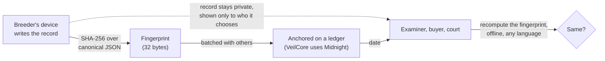

# VeilCore record format

`veilcore-records` on npm · Apache-2.0 · [SPEC.md](SPEC.md) ·
[](https://github.com/hunterincoming/veilcore-sdk/actions/workflows/ci.yml)

An open format for dated records of plant and animal genetic material. A record's fingerprint
is plain SHA-256 over a canonical serialisation, so anyone can check that a record is
unaltered: in any language, offline, with nothing from us. No account, no service, no fee.



## Try it in 30 seconds

Node 20 or later. Download the example record and check it:

```bash
curl -sO https://raw.githubusercontent.com/hunterincoming/veilcore-sdk/main/examples/record.json
npx veilcore-records verify record.json
```

```
vc_rec_example_01

  commitment             holds
                         b14a81acd4bcb71e3931999e18b79f4945295d57c44f06ecc069482a98abb8e3

  attestations           none

  Nobody outside the holder has vouched for this record. That is not a
  fault, but it means the contents rest on the holder's own assertion.

  anchors                none
  dating                 This record states no anchor that could be checked. Its date rests on whoever holds it, not on anything independent.

Verified.
```

Now edit the variety's name in `record.json` (say `"Harbour Mist (example)"` to `"Harbour Mist (edited)"`) and run it again:

```
vc_rec_example_01

  commitment             DOES NOT HOLD
  reason                 commitment does not match contents
  recorded               b14a81acd4bcb71e3931999e18b79f4945295d57c44f06ecc069482a98abb8e3
  computed               f1ba7c0d4da55a7f73fd8b35da2b1aff822f898d6d20a7e4295ce5bd77405d03
  ...
FAILED.
```

Exit status is 0 when it holds and 1 when it doesn't, so it drops into a script. The example
isn't anchored, so the output says its date rests on the holder: dating is the separate step
in the diagram, and a record that names an RFC 3161 timestamp has it checked offline too.

- **151 conformance vectors**, including inputs an implementation must refuse: 121 for the
  record format, the report pairing (SPEC 3.7) and records that name their own key
  (SPEC 3.6.1), and 30 for the animal profile (SPEC 11.8, a draft).
- **Three implementations pass them:** TypeScript (this package), Python (`conformance/impl.py`),
  Rust ([veilcore-rs](https://github.com/hunterincoming/veilcore-rs), which computes the animal
  records' fingerprints and leaves the profile's 25 refusals to this package). We wrote all
  three; one written by someone else is the test the format still needs.
- **Not tied to a chain.** Dating is a separate step. VeilCore anchors on Midnight mainnet;
  an RFC 3161 timestamp is checked offline here.
- **Field sets** (SPEC 4.5) let a holder later prove one fact about a sealed value, such as
  germination of at least 95%, without showing the rest. The proof runs on VeilCore's claims
  contract on Midnight mainnet.

This proves a record hasn't changed since it was sealed. It doesn't prove the contents are
true; lab signatures and the anchor's date are for that.

A breeder cannot prove they held a variety first without showing the genetics. An examiner
cannot confirm a test was run without taking custody of data they would rather not hold.
A laboratory cannot demonstrate chain of custody without exposing its client list. In
each case the party holding the evidence has to overshare or establish nothing. This format
is for proving what a record said and when it existed, and a specific claim about it,
without handing over the underlying data.

---

## Check a record

```
npx veilcore-records verify record.json
```

It reports whether the commitment holds, what the attestations establish, and what the
anchor does and does not date. `seal`, `diff`, `canonical` and `inclusion` are the other
commands; `npx veilcore-records` lists them. From a clone, `node bin/veilcore.mjs` does the same.

The people who need to check a record are examiners, control officials and analysts.
Asking them to write a script is asking them not to check.

### Open a VeilCore backup without VeilCore

```
npx veilcore-records backup "VeilCore backup 2026-10-23.json" --out my-records
```

A backup saved from the VeilCore web app since 23 October 2026 carries each record's sealed
fields and inclusion proof. This checks every record in it (fingerprint, proof, and which
transaction dates its batch) and, with `--out`, writes each record's files to a folder. It
asks for the password if the file has one, and never prints a key. It's how a holder shows
their records if VeilCore's site and registry are gone.

From code:

```js
import { verifyCommitment } from 'veilcore-records';

const result = await verifyCommitment(record);
// { valid: true, computed: '33aaa590...' }
```

An RFC 3161 timestamp anchor is checked offline, with WebCrypto and no dependencies:
`verifyAnchor(record, anchor)` verifies the token's imprint against the commitment, its
signature, and its signer's time-stamping key usage, and reports `genTime`. It does not
check the TSA's certificate chain, its qualified status on an EU trusted list, or
revocation, and says so in every result. Other anchor kinds are reported as lookups.

Verification proves the record is unaltered since sealing. It does **not** prove the
contents are true — that is what attestations and the anchor's date are for. The format
is careful about this distinction throughout, because a format that blurs it is worth
less than no format at all.

---

## Where to go next

**[Integrating VeilCore](INTEGRATING.md)** — start here if you are adding this to
existing software. A laboratory keeps its own system and adds a commitment to records it
already creates.

**[Records in evidence](EVIDENCE.md)** — for counsel. What a party can establish, how it
is authenticated across jurisdictions, and what it does not prove.

**[The specification](SPEC.md)** — record structure, canonical serialisation, the
commitment procedure, anchoring, corrections, attester identity, verification. Written
for implementers rather than users of this package.

**Evidence packages.** `buildEvidencePackage({ record, proof, opentimestamps })` produces
one folder for a lawyer, examiner or court: the record, its inclusion proof, the batch root
and its OpenTimestamps (Bitcoin) file, a plain-English guide, a declaration template for
counsel to adapt, and `verify.py` - this package's Python reference implementation,
standard library only - which checks it all offline with `python3 verify.py`. Nothing in
it depends on VeilCore still existing.

The package's `MANIFEST.json` (the SHA-256 of every file) catches accidental damage only:
a truncated copy, a re-saved file. It does not catch deliberate editing, because it sits
in the same folder and whoever edits a file can rewrite it too. What deliberate editing
cannot get past is the commitment recomputed from `record.json` and that commitment's
anchor. A signature over the manifest would not change this: the package builder is the
holder, the same party who could edit the files, and `verify.py` (Python standard library
only) has no Ed25519 to check one with.

Worked examples in `examples/`: adding commitments to a laboratory's existing intake
process, an Additional Certification Requirement end to end, and establishing
distinctness between two varieties.

---

## Why this is implementable by someone else

A commitment is plain SHA-256 over a canonical serialisation, so any implementation in
any language reproduces it. Anchoring to a chain is a separate step, and only that step
is chain-specific.

Three implementations in different languages pass the same 121 conformance vectors (100
for the record format, one for the report pairing of SPEC 3.7, `dnaPairBinding`, and 20
for records that name their own key, SPEC 3.6.1): this
package (TypeScript), a Python implementation in `conformance/impl.py`, and a Rust
implementation at https://github.com/hunterincoming/veilcore-rs. All three have the same
author. An implementation by an unrelated party is the test this format still needs.

Thirty more vectors cover the animal profile (SPEC 11.8, a draft): five animal records,
whose fingerprints all three compute exactly as any record's, and twenty-five sets of fields
the profile refuses, which this package (`computeAnimalRecordFingerprint`,
`animalIndividualProblems`) and the Python implementation check. The Rust implementation
computes the fingerprints and doesn't check the profile; run it with
`--without-animal-profile`.

```
npm test
```

Runs the unit tests, the check harnesses and the vectors against this implementation.
To run them against another:

```
node conformance/run-cli.mjs "python3 conformance/impl.py"
```

The vectors cover canonicalisation, commitments, what an implementation must REFUSE,
the inclusion fold, the bytes an attester signs, and field sets. The attestation set was
added in September 2026, after this implementation was found to sign an attester's key
while leaving their display name and claimed accreditation outside the signature —
anyone holding a genuine attestation could rewrite those and it still verified. Three
implementations agreeing on how to hash a record says nothing about whether they
agree on what a signature protects, and until there were vectors for it, nothing
asked. The field-set vectors (SPEC 4.5: sixteen values committed one by one, so a holder
can later prove one fact about one value on chain without showing the rest) were added
in October 2026.

Section 5 was written from a clean-room test. Given only that section — no code, no
vectors, no conversation — a language model produced a Go implementation that reproduced
every published batch root and folded every published proof, 19 of 19. It inferred path
direction assignment correctly, which the specification never states: it describes how to
fold a path and not how to build one. The gaps that test exposed are now in the text.

The conformance suite ships a deliberately broken implementation, so anyone can confirm
the suite catches failures rather than passing everything.

---

## Canonical serialisation

A commitment is worthless if two implementations hash the same record differently.

- Committed fields only. `anchor` and `terms` are excluded by definition
- UTF-8, NFC normalised
- Object keys sorted by Unicode code point
- Absent optional fields omitted, never serialised as null
- Array order preserved, never sorted — parent order is meaningful in some domains
- Timestamps RFC 3339, UTC, second precision

---

## The record shape

Three layers. The **envelope** is domain-blind: no field in it names a crop, an animal,
or any subject-specific concept. The **profile** carries the subject fields. The **disclosure
vocabulary** names what a holder can grant.

The test for any proposed envelope field: would a Dutch orchid propagator, a wagyu herd
book and a microbial culture collection all need it?

### Defining a profile for another domain

Write a JSON schema listing your fields, publish it at a path you control, and name it in
`profile`. There is no registry of profiles, because a registry of profiles is a body
that can refuse one.

Published here: `plant-variety-v1`, `seed-lot-v1`, `tissue-culture-accession-v1` and `cannabis-v0.1`.

---

## Proving a single claim

The commitment above establishes that a whole record is unaltered. Establishing a single
claim — that a sealed figure meets a threshold, that two records differ at k or more
fields — without disclosing the record needs a per-field commitment scheme.

Section 4.5 of the specification defines one: field sets, up to sixteen values committed
as separate leaves. The claims themselves (value, range, distinct, unchanged) are proved
by VeilCore's claims contract, on Midnight mainnet since 8 October 2026 at
`ef763eb4ad1846b716dbfa90c00560a9a943ffb4d1fc638b0707df5adefd070d` (no maintenance key).
`examples/acr-trait-verification.mjs` and `examples/distinctness.mjs` show what a
certifying body receives and what stays with the holder.

---

## Using it from Node

The package is ESM (`import`). `require('veilcore-records')` also works on Node versions
that load ES modules through `require` (20.19 and later, 22.12 and later); on older Node,
use `import()`. Attestation signatures use the global WebCrypto with Ed25519 (Node 20 and
later); the tests run on Node 22.

Every `verify…` function returns a failed result for malformed input (a reason, `false`
or `ok: false`) and does not throw. Builders (`computeCommitment`, `buildBatch`,
`buildEvidencePackage`, `sign…`) throw on invalid input, with the reason.

Releases: see [RELEASING.md](RELEASING.md) for the build gate and npm provenance.

## Status

Published for comment. The specification is stable enough to implement against and
specific correction is more useful than general agreement — section 13 says where review
is most needed.

Apache-2.0
